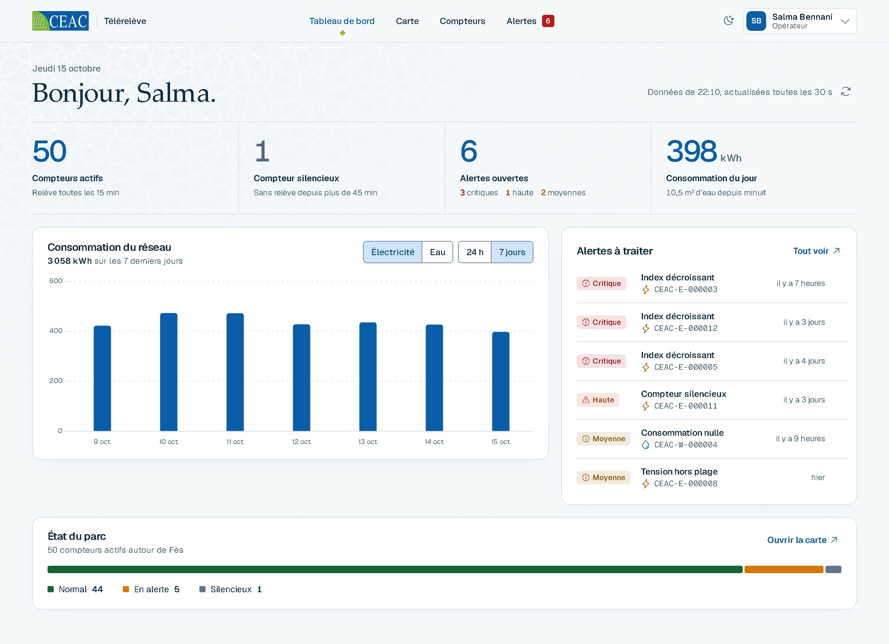
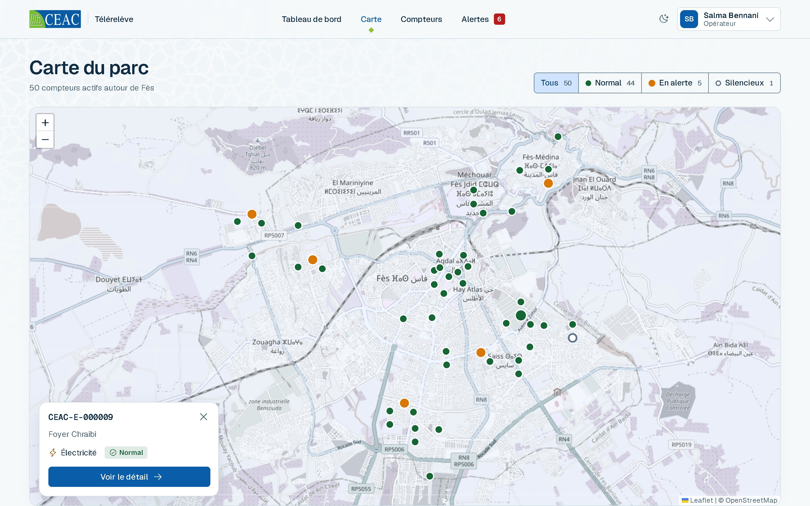
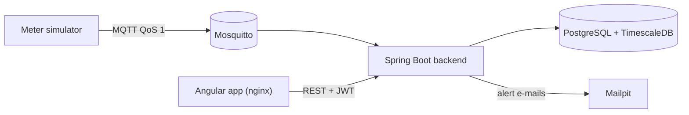

# Télérelève Platform

A remote meter reading platform for electricity and water meters. Smart meters publish their readings over
MQTT; the platform stores them as time series, computes consumption, detects anomalies, raises alerts and
presents everything in a French-language web interface with role-based access.

The platform was built for CEAC Maroc, a manufacturer of electricity and water meters. No real meters or
customer data are involved: a meter simulator produces the readings, and all meters, customers and
addresses are simulated.



## Features

- **Reliable ingestion.** The backend subscribes to the MQTT broker (QoS 1, persistent session), validates
  each reading and stores it idempotently. Nothing is lost when the backend restarts and nothing is stored
  twice.
- **Time-series storage and consumption.** PostgreSQL with TimescaleDB; consumption per hour, day or month,
  computed on a fixed UTC+1 calendar, with CSV export.
- **Anomaly detection.** Five rules (zero consumption, consumption spike, silent meter, decreasing index,
  voltage out of range). One alert per anomaly, resolved automatically when the anomaly disappears.
  High and critical alerts are also sent by e-mail.
- **Alert workflow.** Operators filter alerts, assign them to technicians and follow their status;
  technicians see and handle only the alerts assigned to them.
- **Web interface.** Dashboard with key figures and trends, interactive fleet map, meter details,
  administration of users, meters and detection thresholds. Light and dark themes, responsive layout.
- **Security.** JWT authentication, three roles (administrator, operator, technician) enforced on every
  route, BCrypt password hashing, secrets kept in environment variables.



## Architecture



| Layer | Technologies |
|---|---|
| Backend | Java 21, Spring Boot 3.5 (Web, Data JPA, Security, Actuator), Flyway, springdoc-openapi |
| Messaging | Eclipse Mosquitto 2, Spring Integration MQTT |
| Database | PostgreSQL 16, TimescaleDB |
| Frontend | Angular 22, Angular Material 3, Chart.js, Leaflet, nginx |
| Tests | JUnit 5, Mockito, Testcontainers, JaCoCo, Vitest |
| Delivery | Docker, Docker Compose, GitHub Actions |

Design documents: [architecture](docs/architecture.md) (diagrams, data model, security) and
[technical decisions](docs/decisions.md) (the reasoning behind each significant choice).

## Quick start

Prerequisite: Docker (Docker Desktop on Windows and macOS).

```sh
cp .env.example .env       # PowerShell: Copy-Item .env.example .env
```

Edit `.env` and replace every `change-me` with your own value. `JWT_SECRET` must be a random base64 key:

```sh
openssl rand -base64 48
```

Then build and start everything (the first build takes a few minutes):

```sh
docker compose up --build
```

| Address | Service |
|---|---|
| <http://localhost:4200> | Web interface |
| <http://localhost:8080/swagger-ui.html> | REST API documentation |
| <http://localhost:8025> | Mailpit, which receives the alert e-mails |
| <http://localhost:8080/actuator/health> | Backend health |

Stop with `docker compose down` (add `-v` to delete the data as well).

### Demo accounts

Created by the development profile only. All use the password set in `APP_SEED_DEMO_PASSWORD` (`.env`).
Never use these accounts or that password in a real deployment.

| Username | Role | Access |
|---|---|---|
| `admin` | Administrator | Meters, users, detection thresholds |
| `operateur` | Operator | Supervision, alert handling, assignment to technicians |
| `technicien`, `technicien2` | Technician | Map, dashboard, own alerts |

### Demo scenario

By default the simulator runs 50 meters around Fès: it publishes four days of history, then one reading
per meter per minute, and injects one anomaly per detection rule so that every kind of alert appears
within minutes.

| Meter | Injected anomaly | Expected alert |
|---|---|---|
| `CEAC-W-000004` | consumption stops | A1 zero consumption (medium) |
| `CEAC-E-000012` | one hour at five times the usual consumption | A2 spike (medium), resolved automatically |
| `CEAC-E-000011` | stops publishing | A3 silent meter (high, e-mailed) |
| `CEAC-E-000005` | index decreases | A4 decreasing index (critical, e-mailed) |
| `CEAC-E-000008` | voltage around 260 V | A5 voltage out of range (medium) |

The [user guide](docs/user-guide.md) (French) describes every screen.

## Development

Run the infrastructure in Docker and the backend from your IDE or the command line (JDK 21 or later):

```sh
docker compose up -d timescaledb mosquitto mailpit
cd backend
./mvnw spring-boot:run
```

Frontend with live reload (Node 24). Stop the `frontend` container first, as it uses the same port:

```sh
cd frontend
npm install
npm start                  # http://localhost:4200, /api proxied to the backend on :8080
```

The frontend can also run without a backend, on a simulated API in the browser: see
[frontend/README.md](frontend/README.md).

### Tests

```sh
cd backend   && ./mvnw verify              # unit and integration tests (Testcontainers needs Docker)
cd simulator && ./mvnw verify
cd frontend  && npx ng test --watch=false  # Vitest
```

The test inventory, coverage and load-test results are in the [test report](docs/test-report.md). A full
run with 1000 meters (`APP_SEED_METER_COUNT=1000`) stored 532,610 readings with no loss and no duplicate,
and the dashboard loaded in under a second.

GitHub Actions (`.github/workflows/ci.yml`) runs the tests on every push and pull request, publishes the
coverage report and builds the Docker images.

## Troubleshooting

| Symptom | Cause and fix |
|---|---|
| `Set JWT_SECRET in .env` (or another variable) | `.env` is missing or incomplete: create it from `.env.example` |
| `JWT_SECRET must be base64-encoded` | `JWT_SECRET` is still the example value: generate a key |
| Port 4200, 8080 or 5432 already in use | Stop the other program or change `FRONTEND_PORT`, `BACKEND_PORT` or `POSTGRES_PORT` in `.env` |
| Signed out after a page reload | Intended: the session is kept in memory only, for security |
| No reading arrives | `docker compose logs simulator`: it waits for the backend, then reports once a minute |

## Repository layout

```text
backend/     Spring Boot application
simulator/   Smart meter simulator (standalone Java application)
frontend/    Angular application, served by nginx in Docker
docker/      Infrastructure configuration (Mosquitto)
docs/        Architecture, technical decisions, test report, user guide (French)
```

## Known limits

Data is simulated and the platform has not been connected to real meters. Transport between components is
not encrypted in the demo setup (TLS for MQTT and HTTPS are the first production hardening steps), and a
single MQTT consumer handles ingestion. These and other next steps are listed at the end of the
[test report](docs/test-report.md).

The CEAC name, logo and pattern in the interface belong to CEAC Maroc and are used here for demonstration.
