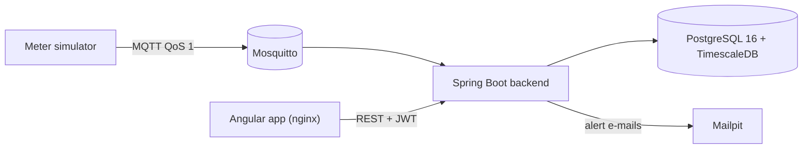

# CEAC Télérelève Platform

Remote meter reading platform for **CEAC Maroc** (Fès), a manufacturer of electricity and water meters.
Smart meters publish their readings over **MQTT**; the platform stores them as **time series**, computes
consumption, detects anomalies (fault, fraud, abnormal consumption), raises alerts (e-mailed when
serious) and shows everything in a French web interface.

Real meters are out of scope: a realistic **meter simulator** produces the readings. **All data is
simulated** (meters, customers, addresses).

*[Screenshot: dashboard]*

## Run it (5 minutes)

Prerequisite: **Docker** (Docker Desktop on Windows / macOS, started). Nothing else: Java and Node are
only needed to develop outside containers.

1. Create your configuration from the example:

   ```sh
   cp .env.example .env        # Windows PowerShell: Copy-Item .env.example .env
   ```

2. Edit `.env` and replace every `change-me` with your own values. `JWT_SECRET` needs a random base64
   key, for example:

   ```sh
   openssl rand -base64 48
   # or in PowerShell: [Convert]::ToBase64String((1..48 | ForEach-Object { Get-Random -Maximum 256 }))
   ```

3. Build and start everything (the first build takes a few minutes):

   ```sh
   docker compose up --build
   ```

4. Open <http://localhost:4200> and sign in with a demo account. They all use the password
   `APP_SEED_DEMO_PASSWORD` from `.env` (`demo1234` in the example):

   | Username | Role | What they do |
   |---|---|---|
   | `admin` | Administrator | Meters, users, detection thresholds |
   | `operateur` | Operator | Supervision, alert handling, assignment to technicians |
   | `technicien`, `technicien2` | Technician | Map, dashboard, the alerts assigned to them |

Stop with `docker compose down` (add `-v` to also delete the data).

| Address | What |
|---|---|
| <http://localhost:4200> | Web interface |
| <http://localhost:8080/swagger-ui.html> | REST API documentation (Swagger UI; *Authorize* with a token from `POST /api/auth/login`) |
| <http://localhost:8025> | Mailpit: the alert e-mails sent by the platform |
| <http://localhost:8080/actuator/health> | Backend health |
| `localhost:1883` / `localhost:5432` | MQTT broker (authenticated) / PostgreSQL + TimescaleDB |

## A 5-minute tour

The compose defaults run a **demo scenario**:
- 50 meters around Fès;
- the simulator first publishes 4 days of history, then one reading per meter per minute;
- it injects one anomaly per detection rule, started 25 hours ago, so every alert appears within minutes.

| Meter | Injected anomaly | Expected alert |
|---|---|---|
| `CEAC-W-000004` | consumption stopped | A1 zero consumption (MEDIUM) |
| `CEAC-E-000012` | one hour at 5 times the usual consumption | A2 spike (MEDIUM), then resolved automatically |
| `CEAC-E-000011` | stops publishing | A3 silent meter (HIGH, e-mailed) |
| `CEAC-E-000005` | index goes down | A4 decreasing index (CRITICAL, e-mailed) |
| `CEAC-E-000008` | voltage around 260 V | A5 voltage out of range (MEDIUM) |

1. As `operateur`, look at the **dashboard**: key figures, network consumption, alerts to handle.
2. On the **map**, spot the meters in alert and the silent one.
3. Open **Alertes** and assign the A4 alert to *Hamza Tazi*.
4. Open <http://localhost:8025> to read the HIGH and CRITICAL alert e-mails.
5. Sign out, sign in as `technicien`: only the assigned alert is listed; take charge of it.
6. As operator, open a meter from **Compteurs**: consumption per hour, day or month, CSV export.

*[Screenshots: map, meter detail, alerts]*

Every screen is described in the [user guide (French)](docs/user-guide.md).

## How it works



- **Ingestion**: the backend subscribes to `ceac/meters/+/readings`, validates each reading and stores it
  idempotently. Nothing is lost when the backend restarts, and nothing is stored twice.
- **Anomaly detection**: five rules (A1-A5) run on each reading or every 5 minutes, raise one alert per
  anomaly, resolve it automatically when it is gone, and e-mail HIGH and CRITICAL alerts.
- **Consumption**: TimescaleDB `time_bucket` per hour, day or month, on Moroccan time.
- **Security**: JWT login, three roles checked on every route, technicians limited to their own alerts.

Details: [architecture](docs/architecture.md) (diagrams, data model, security) and the
[technical decisions](docs/decisions.md) (D1-D36, the reason behind each choice).

| Layer | Technologies |
|---|---|
| Backend | Java 21, Spring Boot 3.5 (Web, Data JPA, Validation, Security, Actuator), Flyway, springdoc |
| Messaging | Eclipse Mosquitto 2, Spring Integration MQTT (Paho) |
| Database | PostgreSQL 16 + TimescaleDB |
| Frontend | Angular 22, Angular Material 3, Chart.js, Leaflet, nginx |
| Tests | JUnit 5, Mockito, AssertJ, Testcontainers, JaCoCo, Vitest |
| DevOps | Docker, Docker Compose, GitHub Actions |

## Developing

Infrastructure in Docker, backend from your IDE or the command line (JDK 21 or later):

```sh
docker compose up -d timescaledb mosquitto mailpit
cd backend
./mvnw spring-boot:run          # reads ../.env automatically
```

Frontend with live reload (Node 24). Stop the `frontend` container first: it also uses port 4200.

```sh
cd frontend
npm install
npm start                       # http://localhost:4200, /api proxied to the backend on :8080
```

The frontend can also run without any backend, on a simulated API in the browser: see
[frontend/README.md](frontend/README.md).

Tests (inventory and results in the [test report](docs/test-report.md)):

```sh
cd backend   && ./mvnw verify               # unit + integration tests (Testcontainers: Docker needed) + coverage
cd simulator && ./mvnw verify
cd frontend  && npx ng test --watch=false   # Vitest
```

GitHub Actions (`.github/workflows/ci.yml`) runs them all on every push and pull request, uploads the
JaCoCo report and builds the Docker images.

To try 1000 meters, set `APP_SEED_METER_COUNT=1000` in `.env`; the load test results are in the
[test report](docs/test-report.md).

## Troubleshooting

| Symptom | Cause and fix |
|---|---|
| `Set JWT_SECRET in .env` (or another variable) | `.env` missing or incomplete: steps 1 and 2 |
| Backend stops at startup: `JWT_SECRET must be base64-encoded` | `JWT_SECRET` is still the example value: generate a key (step 2) |
| Port 4200, 8080 or 5432 already in use | Stop the other program, or change `FRONTEND_PORT`, `BACKEND_PORT` or `POSTGRES_PORT` in `.env` |
| Signed out after reloading the page | Intended: the session is kept in memory only, for security (D16). Sign in again |
| No reading arrives | `docker compose logs simulator`: it waits for the backend, then reports once a minute |

## Repository layout

```text
backend/     Spring Boot application (package ma.ceac.telereleve)
simulator/   Smart meter simulator (standalone Java 21)
frontend/    Angular application, served by nginx in Docker
docker/      Infrastructure configuration (Mosquitto)
docs/        architecture.md, decisions.md, test-report.md, user-guide.md (FR), rapport.md (FR)
```

## Status

All six phases are done:
- Phase 0: setup;
- Phase 1: meters and simulator;
- Phase 2: MQTT ingestion and consumption;
- Phase 3: anomaly detection and alerts;
- Phase 4: JWT security and roles;
- Phase 5: Angular frontend;
- Phase 6: load test with 1000 meters, full Docker Compose, final documentation.

Known limits and next steps are listed at the end of the [test report](docs/test-report.md).
