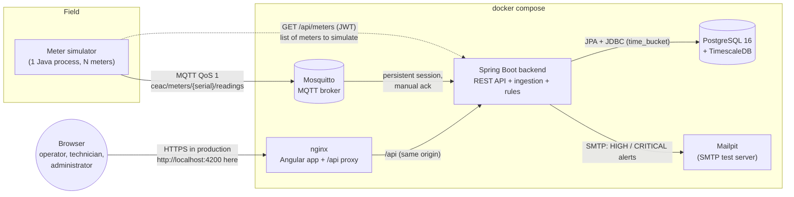
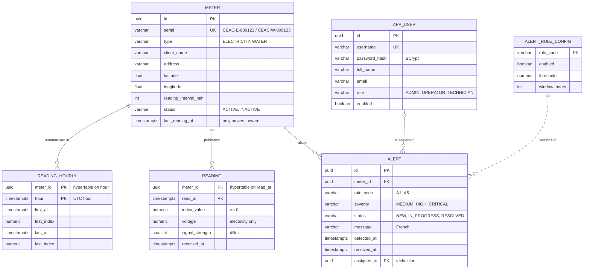
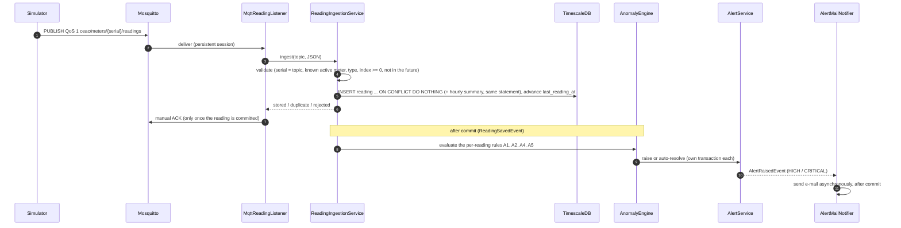
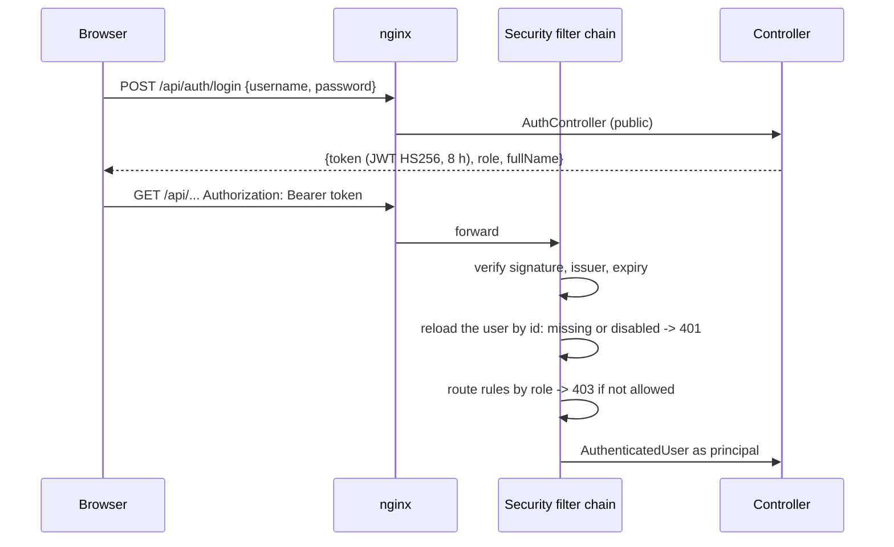

# Architecture

How the Télérelève platform is built. The reasons behind each choice are in [decisions.md](decisions.md)
(referenced below as D1, D2, ...).

## 1. Overview

Smart meters (simulated here) publish their readings over MQTT. The backend stores them in a time-series
database, computes consumption, detects anomalies and raises alerts (e-mailed when serious). Operators,
technicians and administrators use an Angular web application.



| Component | Technology | Role |
|---|---|---|
| Simulator | Java 21, Eclipse Paho | Publishes one reading per meter and per interval; can backfill history and inject anomalies (D18, D19, D28) |
| Mosquitto | Eclipse Mosquitto 2 | Authenticated MQTT broker; keeps queued messages for the backend's persistent session (D22, D27) |
| Backend | Java 21, Spring Boot 3.5 | Ingestion, consumption, anomaly rules, alerts, e-mail, security, REST API with Swagger UI |
| Database | PostgreSQL 16 + TimescaleDB | `reading` is a hypertable (1-day chunks); consumption uses `time_bucket` (D3, D21) |
| Mailpit | Mailpit | Catches the e-mails in development (web UI on port 8025) |
| Frontend | Angular 22, Angular Material, Leaflet, Chart.js, nginx | French web interface; nginx serves it and forwards `/api` so the browser sees one origin (D29) |

## 2. Data model

Two Flyway migrations in `backend/src/main/resources/db/migration`: `V1__init_schema.sql` (the model
of the specification) and `V2__reading_hourly.sql` (hourly summary, D36). Enumerations are `VARCHAR` with
`CHECK` constraints.



Two constraints carry business rules:
- the primary key `(meter_id, read_at)` makes ingestion idempotent: a reading delivered twice is stored
  once (`INSERT ... ON CONFLICT DO NOTHING`);
- a partial unique index allows only one open alert (NEW or IN_PROGRESS) per meter and rule.

`reading_hourly` keeps the first and last reading of each meter in each hour. It is written in the same
statement as each reading, and lets the dashboard compute network consumption from 24 rows per meter and
day instead of every reading (D36).

## 3. Reading ingestion and anomaly detection



- **No loss:** the backend's MQTT session is persistent (`cleanSession=false`, fixed client id) and a
  message is acknowledged only after its reading is committed. If the backend stops, Mosquitto keeps the
  messages and delivers them on reconnection (D22, D27).
- **No duplicate:** QoS 1 may deliver a message twice; the primary key turns the second insert into a no-op.
- **Detection never blocks collection:** rules run after the commit, and a failing rule is logged without
  affecting the reading or the other rules.
- **A3 (silent meter)** cannot be triggered by a reading (it detects their absence): `AnomalyScheduler`
  checks every active meter every 5 minutes, and waits while ingestion is catching up a backlog (D26).

### Rules engine

Each rule is a Spring component implementing `AnomalyRule` (strategy pattern). The engine receives the
list of rules and knows none of them by name. Rules read history through the `ReadingHistory` interface
(SQL in production, in memory in unit tests) and their settings from `alert_rule_config`, with defaults
when a row is missing.

| Rule | Trigger | Severity | Condition (defaults) | Auto-resolved |
|---|---|---|---|---|
| A1 Zero consumption | reading | MEDIUM | index unchanged for 24 h | yes |
| A2 Spike | reading | MEDIUM | last hour > 3 x the same hour's average over 7 days (>= 3 days of data, readings near both ends of each hour, D31) | yes |
| A3 Silent meter | every 5 min | HIGH | no reading for more than 3 reading intervals | yes |
| A4 Decreasing index | reading | CRITICAL | index lower than the previous reading | no: checked on site |
| A5 Voltage | reading | MEDIUM | voltage outside 230 V +/- 10 % (electricity) | yes |

## 4. Consumption

Consumption is the difference between successive indexes, never negative (a decrease is A4's business).
`ReadingRepository` aggregates with TimescaleDB `time_bucket` and `first()` / `last()` per bucket;
`ConsumptionCalculator` subtracts each bucket's last index from the previous reference. Days and months
follow Moroccan legal time as a fixed UTC+1 offset, on the backend and in the frontend (D21, D33). The
network curve of the dashboard applies the same rules in one SQL query over all meters (D32), reading the
hourly summary `reading_hourly` rather than every reading (D36).

## 5. Security



- Stateless JWT signed with `JWT_SECRET`; passwords hashed with BCrypt (D29).
- Every route is listed with its roles in `SecurityConfig`; anything else is refused (deny by default).
- Row-level rules live in the services: a technician only sees and updates the alerts assigned to them.
- The token is kept in memory in the browser, never in `localStorage` (D16).

| Route | ADMIN | OPERATOR | TECHNICIAN |
|---|:-:|:-:|:-:|
| `POST /api/auth/login` | public | public | public |
| `GET /api/meters`, `/api/meters/{id}`, consumption, CSV export | yes | yes | no |
| `POST /api/meters`, `PUT /api/meters/{id}` | yes | no | no |
| `GET /api/meters/map`, `/api/dashboard/*` | yes | yes | yes |
| `GET /api/alerts` | yes | yes | own alerts |
| `PATCH /api/alerts/{id}` | no | yes | own alerts |
| `/api/rules/**`, `/api/users/**` | yes | no | no |
| `GET /api/users/technicians` | yes | yes | no |

## 6. Code organisation

```text
backend/src/main/java/ma/ceac/telereleve/
  meter/      Meter entity, CRUD, demo meter generator around Fès
  reading/    MQTT listener, validation, idempotent storage, consumption, CSV export
  anomaly/    AnomalyRule and the five rules, engine, scheduler, rule settings
  alert/      Alert lifecycle, assignment, e-mail notification
  dashboard/  Map markers, key figures, network consumption
  user/       Users, login, JWT
  config/     Security, MQTT, OpenAPI, scheduling, dev data seeder
  common/     RFC 7807 error handling, paging, exceptions

frontend/src/app/
  core/       API clients (typed), auth store and guards, HTTP interceptors, models, mock API
  features/   one folder per screen: login, dashboard, map, meters, alerts, admin
  shared/     calendar (UTC+1), formatting, chart, map tiles, UI components
  layout/     application shell (navigation by role)
```

Layers in the backend: controller (HTTP, validation, DTO records) -> service (business rules,
transactions) -> repository (Spring Data JPA, or `JdbcTemplate` for TimescaleDB SQL). Errors are RFC 7807
`ProblemDetail` responses with a French `detail` that the frontend shows as is.

## 7. Deployment

`docker compose up --build` builds and starts the six services on one machine:

| Service | Image | Port (host) |
|---|---|---|
| `timescaledb` | `timescale/timescaledb:2.30.2-pg16` | 5432 |
| `mosquitto` | `eclipse-mosquitto:2.0.22` (password file generated at startup) | 1883 |
| `mailpit` | `axllent/mailpit:v1.31.5` | 8025 (web), 1025 (SMTP) |
| `backend` | built from `backend/Dockerfile` (JRE 21, non-root) | 8080 |
| `simulator` | built from `simulator/Dockerfile` | - |
| `frontend` | built from `frontend/Dockerfile` (nginx) | 4200 |

Secrets (database, MQTT and JWT keys, passwords) come from `.env`, never from the code; compose stops
with a clear message when one is missing. Health checks order the startup: database and broker, then
backend, then simulator and frontend. The `dev` Spring profile seeds demo data and must not be used in
production.

Continuous integration (`.github/workflows/ci.yml`) builds and tests the backend (unit and
Testcontainers integration tests, JaCoCo report and the 70 % coverage gate on `anomaly`), the simulator
and the frontend (Vitest and production build), and builds the Docker images.
