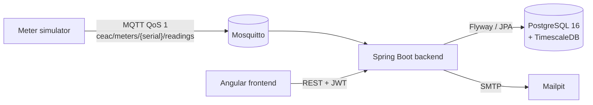

# Architecture

> Work in progress: completed in Phase 6 with the final diagram and component descriptions.

## Overview

## Repository layout

| Folder | Content |
|---|---|
| `backend/` | Spring Boot application, package `ma.ceac.telereleve`, one sub-package per feature |
| `simulator/` | Standalone Java 21 application publishing simulated readings over MQTT |
| `frontend/` | Angular application (Phase 5) |
| `docker/` | Configuration of infrastructure containers (Mosquitto) |
| `docs/` | Architecture, decisions, test report, user guide |

## Data model

Defined by Flyway migrations in `backend/src/main/resources/db/migration`.

| Table | Role |
|---|---|
| `meter` | Smart meters (electricity or water) with location and reading interval |
| `reading` | Time series of index readings, TimescaleDB hypertable on `read_at` |
| `alert` | Anomalies detected by the rules engine, with their lifecycle |
| `alert_rule_config` | Enabled flag and thresholds of rules A1–A5 |
| `app_user` | Platform users and their role (ADMIN, OPERATOR, TECHNICIAN) |
